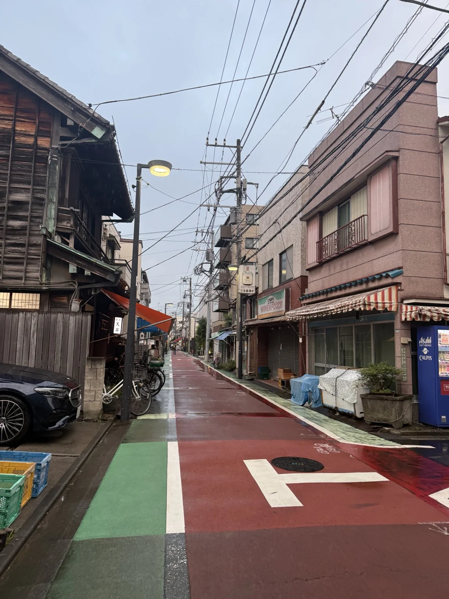
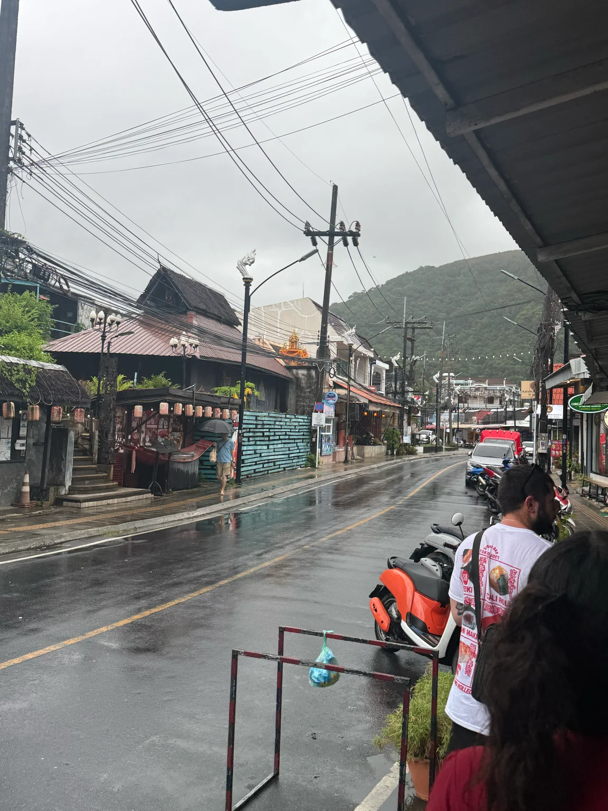
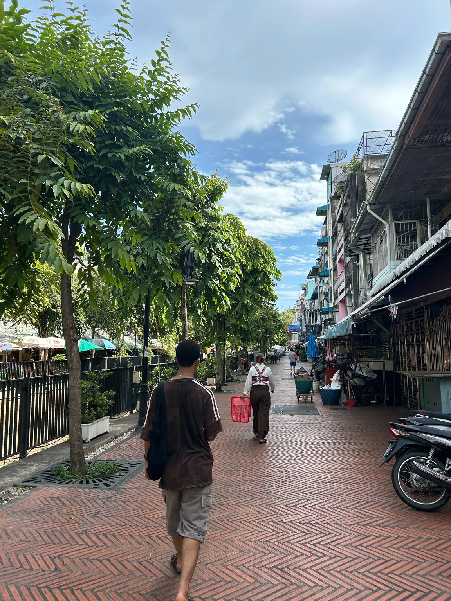
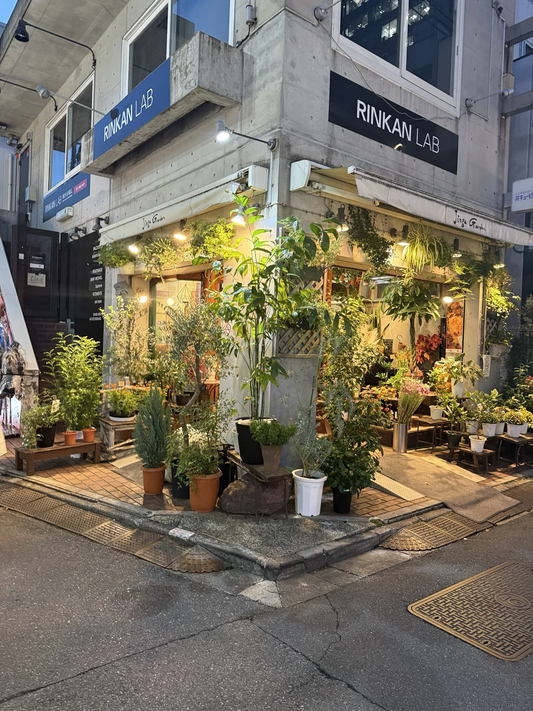
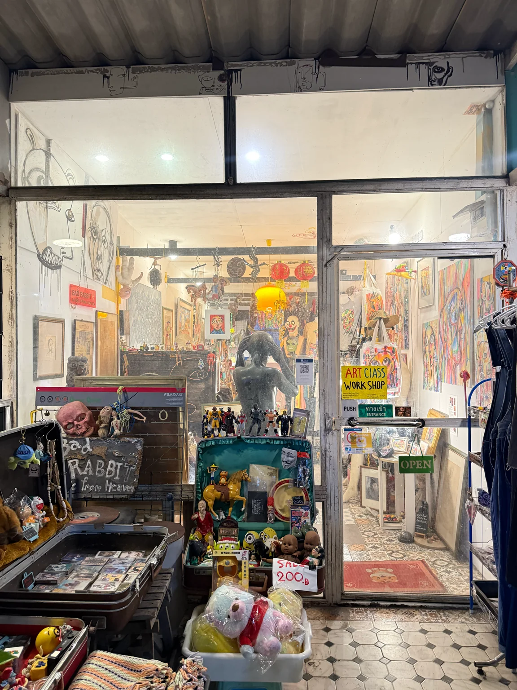
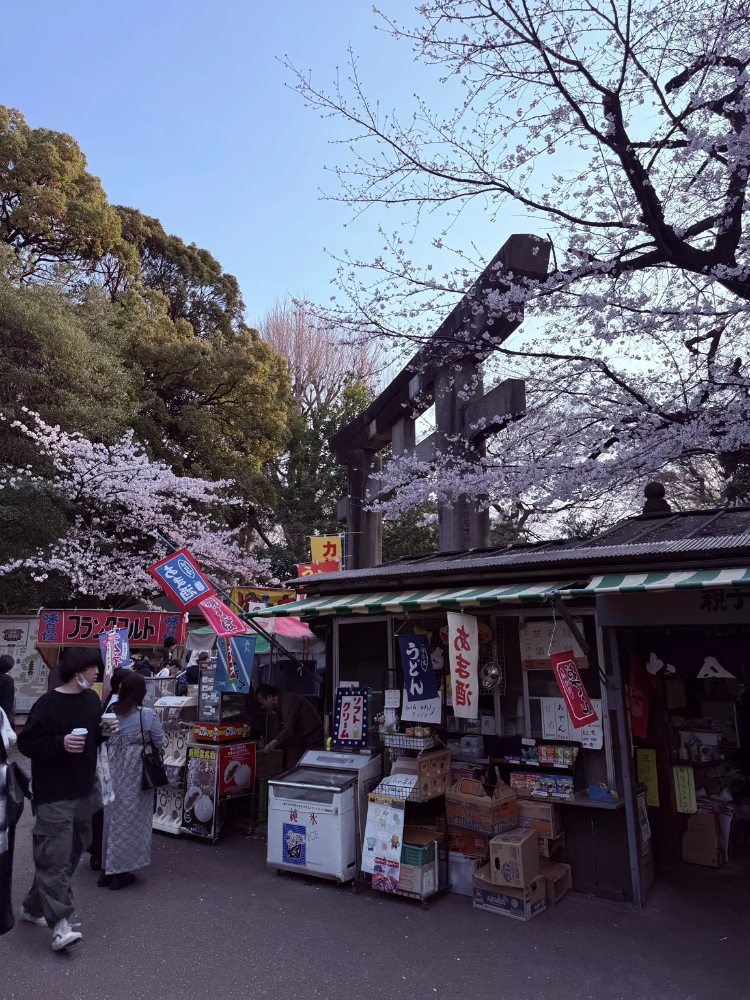
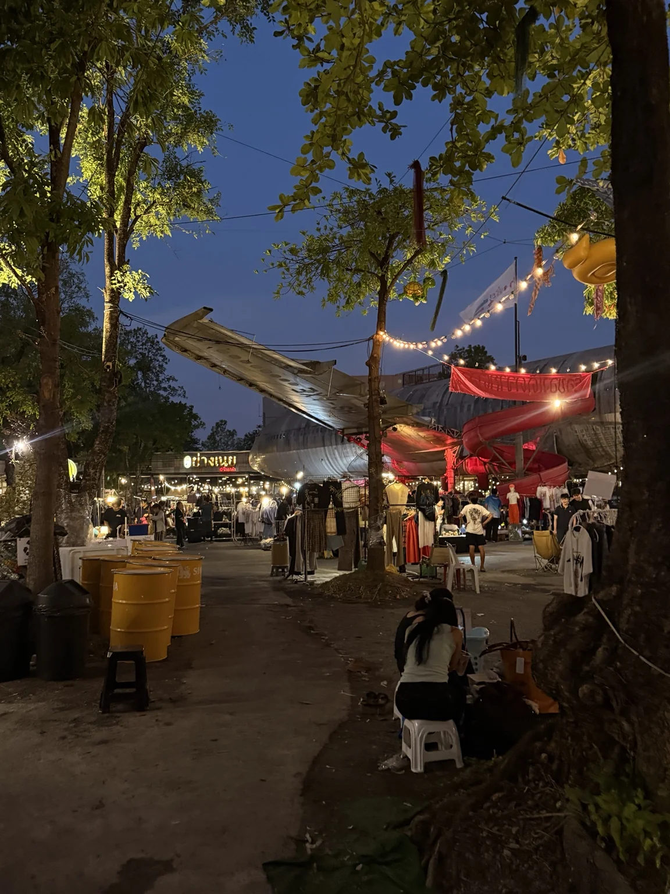
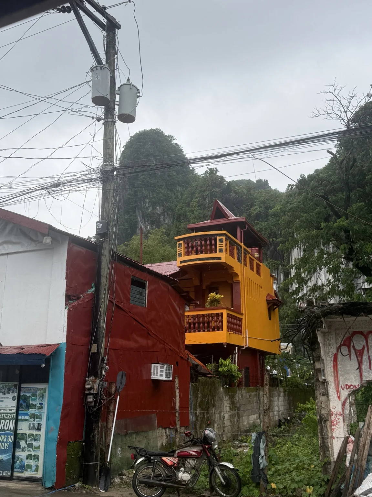

A plan can determine where a road runs or what a building is for. It cannot quite determine what a place will feel like once people begin using it. Shopfronts spread onto pavements; trees change the experience of a walk; a familiar street takes on a different character after rain.

These photographs were made in different places, but they share an interest in that ordinary second life of the built environment. There are no grand skylines here. Instead, there are small businesses full of objects and plants, temporary stalls beneath cherry blossoms and an aircraft that has become part of a market.

The scenes are not evidence that cities are unplanned, or that one approach to urban development is better than another. They simply show what a plan cannot capture in advance: the marks of individual choices, the uses that accumulate, and the details that make somewhere worth looking at twice. Where <em>On Display</em> considers the public image of a city, these photographs look at what happens closer to the ground.

<figure style="margin:2rem 0"><figcaption><strong>Tokyo, Japan</strong>. An older wooden frontage faces a pink building across a newly coloured road. The street seems to have been assembled one decision at a time.</figcaption></figure>

<figure style="margin:2rem 0"><figcaption><strong>Phuket, Thailand</strong>. Rain changes the surface of a familiar road. Awning, wires, shopfronts and passing scooters share the same narrow view.</figcaption></figure>

<figure style="margin:2rem 0"><figcaption><strong>Bangkok, Thailand</strong>. A path becomes a place to walk slowly: trees, a low railing, small businesses and people moving through at their own pace.</figcaption></figure>

<figure style="margin:2rem 0"><figcaption><strong>Tokyo, Japan</strong>. The plants begin inside the shop and spill around the corner. The street receives a little of the business’s personality.</figcaption></figure>

<figure style="margin:2rem 0"><figcaption><strong>Bangkok, Thailand</strong>. Drawings, objects and workshop signs fill the window almost to its edges. This shop makes no attempt to disappear into the streetscape.</figcaption></figure>

<figure style="margin:2rem 0"><figcaption><strong>Tokyo, Japan</strong>. A few temporary stalls gather beneath the blossoms. For a short season, the setting acquires another use.</figcaption></figure>

<figure style="margin:2rem 0"><figcaption><strong>Bangkok, Thailand</strong>. At an evening market, the wing of a grounded aircraft becomes part of the streetscape. An object built for movement acquires a life in one place.</figcaption></figure>

<figure style="margin:2rem 0"><figcaption><strong>El Nido, Philippines</strong>. A yellow house insists on being seen among red walls, cables and a limestone hillside. It needs no skyline to hold your attention.</figcaption></figure>

The most memorable parts of a place are not always its designated landmarks. Sometimes they are the arrangements that emerge in the years—or just the hours—after a space begins to be used.

Companion photo essay: [On Display](/writing/on-display/).
