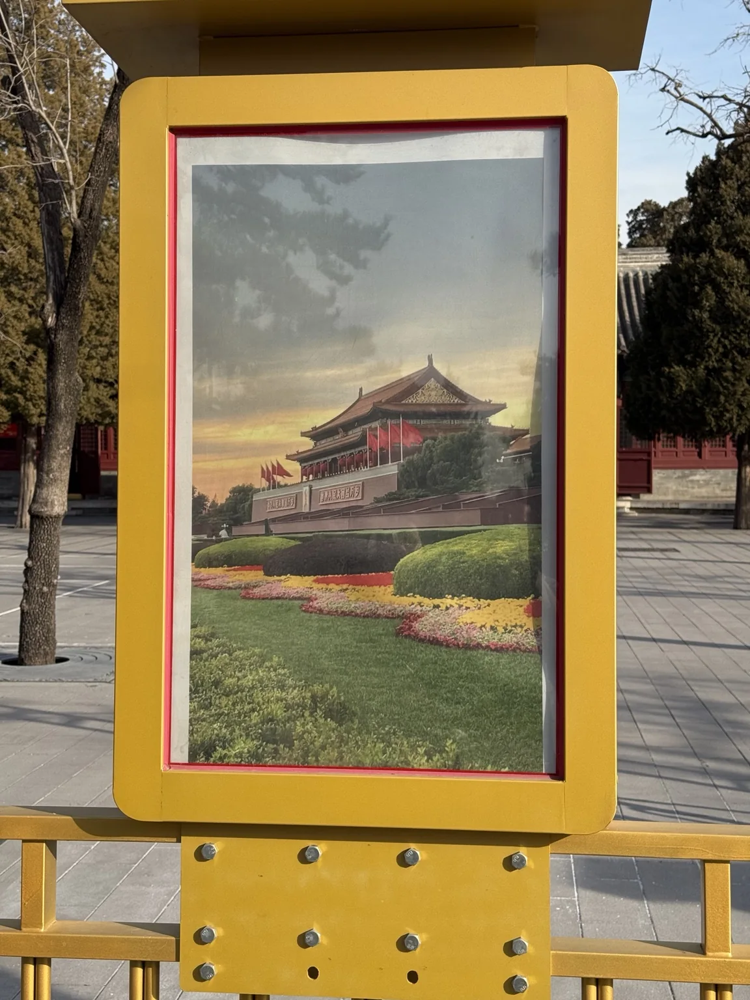
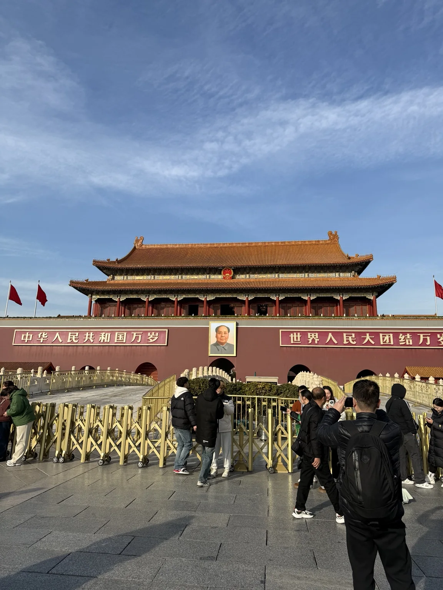
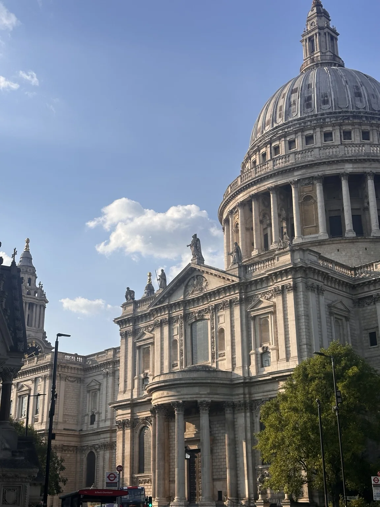
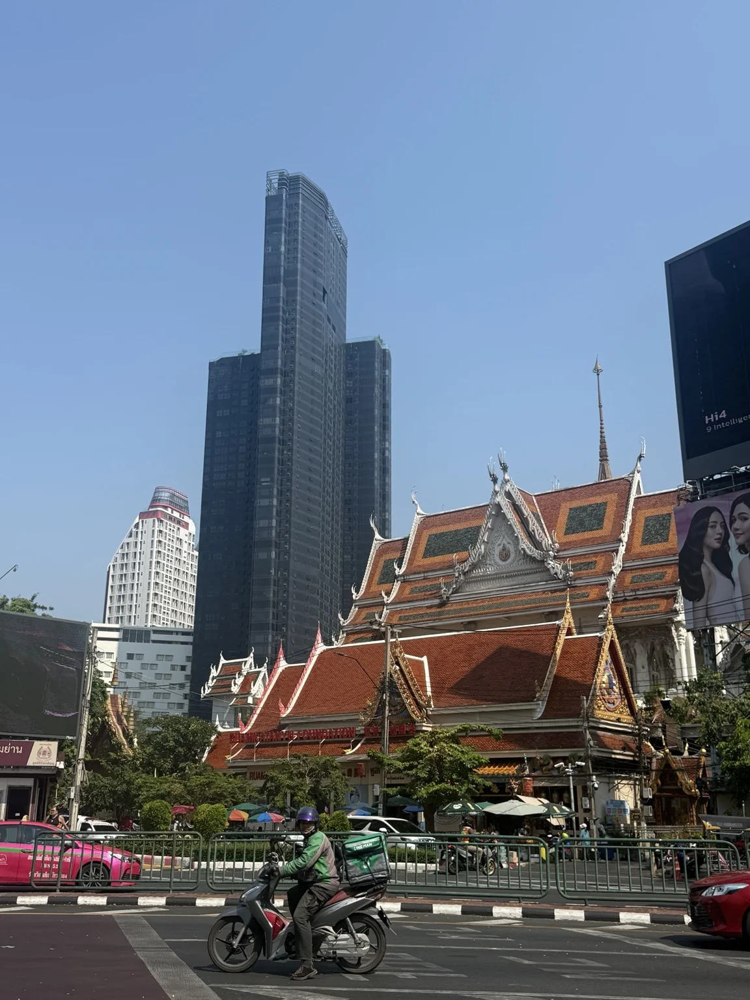
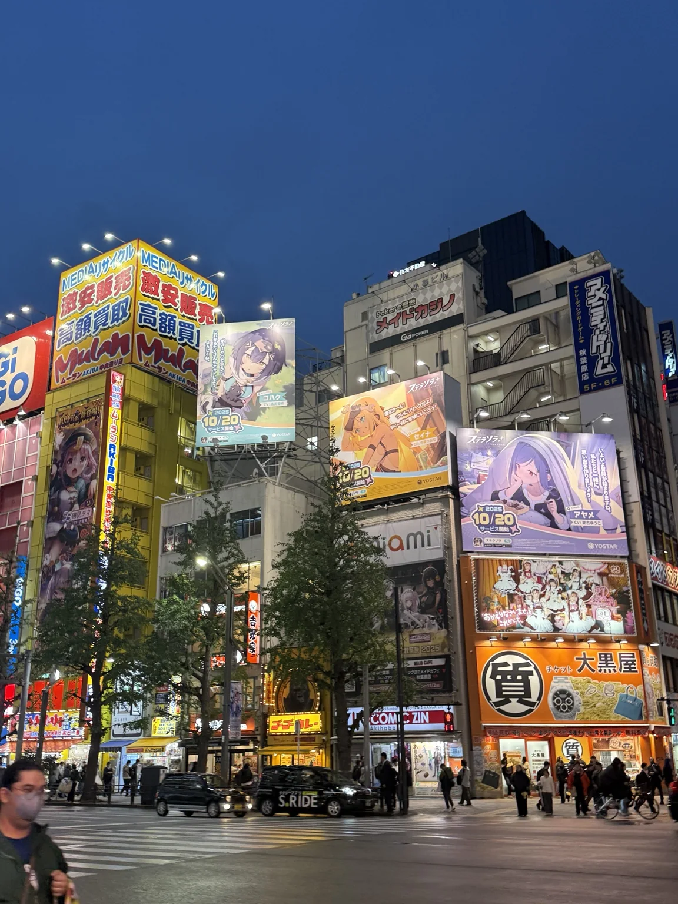
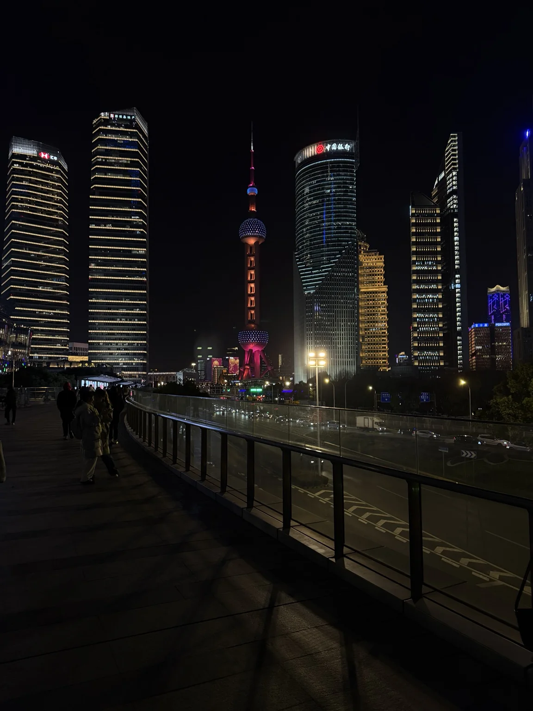
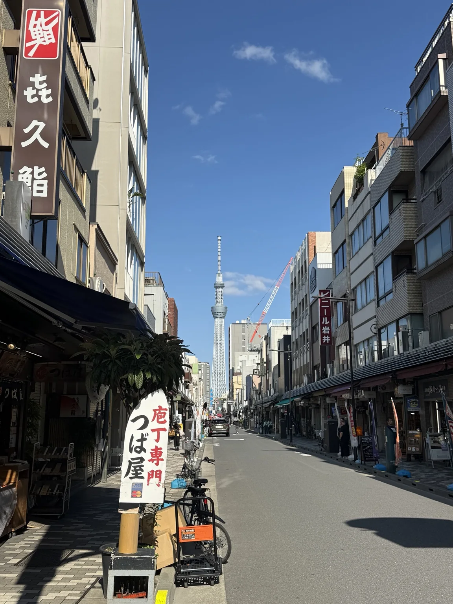

<figure><figcaption><strong>Beijing, China</strong> A picture of Tiananmen before the place itself: the landmark already framed for us.</figcaption></figure>
<figure><figcaption><strong>Beijing, China</strong> The landmark itself, seen among visitors, cameras and crowd-control barriers.</figcaption></figure>

Some places are familiar long before we arrive. Tiananmen is recognisable by its red walls and portrait; St Paul’s by its dome; Shanghai by the illuminated towers of Pudong. Seen often enough, a building becomes shorthand for a city, an institution, even an idea of what a place ought to be.

<figure><figcaption><strong>London, United Kingdom</strong> St Paul’s rises above the street, its stonework and dome giving it a commanding place in the city.</figcaption></figure>

In Beijing, I photographed both a framed picture of Tiananmen and the gate itself. One image shows a monument composed to be admired. In the other, visitors stop, raise their phones and move among barriers. Both depict the same place, but they ask us to look at it differently.

<figure><figcaption><strong>Bangkok, Thailand</strong> A temple roof and a glass tower share a sightline. Bangkok does not arrange its histories into separate frames.</figcaption></figure>
<figure><figcaption><strong>Tokyo, Japan</strong> In Akihabara, shopfronts and building façades become a layered field of images, brands and characters.</figcaption></figure>

The photographs that follow move between religious architecture, a temple set against a tower, advertisements that cover entire buildings and skylines designed to be seen from afar. They are not all expressions of the same power or purpose. What connects them is the space between what a place looks like as an image and what comes into view when we are actually there.

<figure><figcaption><strong>Shanghai, China</strong> Pudong after dark: a skyline made legible through height, light and a carefully recognisable silhouette.</figcaption></figure>

<figure><figcaption><strong>Tokyo, Japan</strong> Tokyo Skytree at the end of an ordinary street—still iconic, but no longer the whole picture.</figcaption></figure>

A landmark does not lose its significance when it appears behind parked bicycles or a shop sign. It simply returns to the larger city around it. No image is necessarily false; none is the whole place.

Companion photo essay: [After the Blueprint](/writing/after-the-blueprint/).

